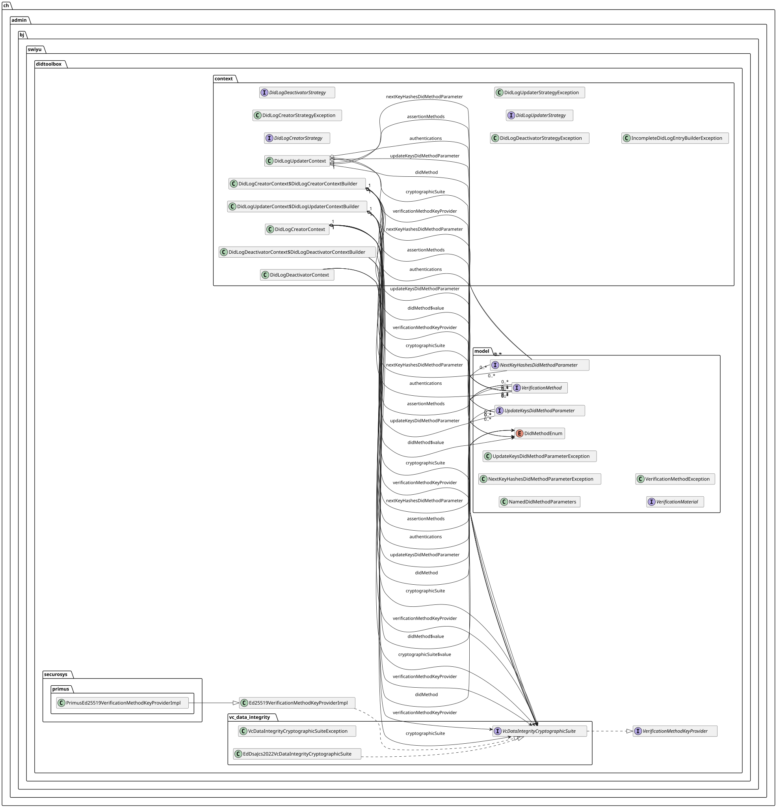
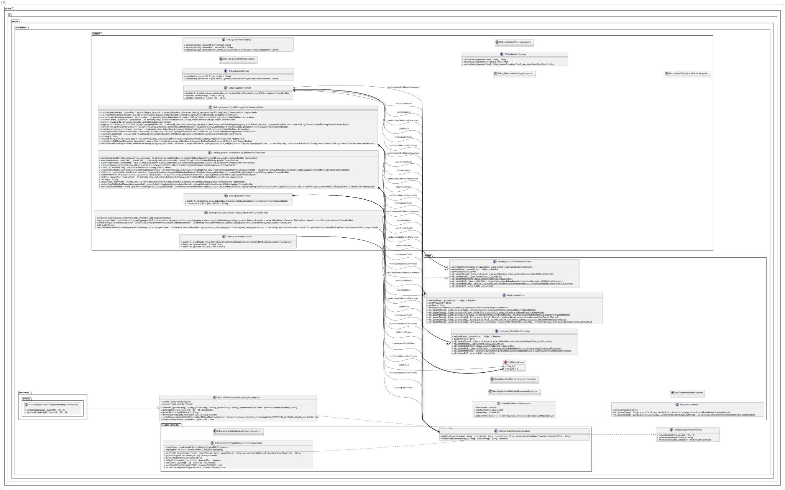
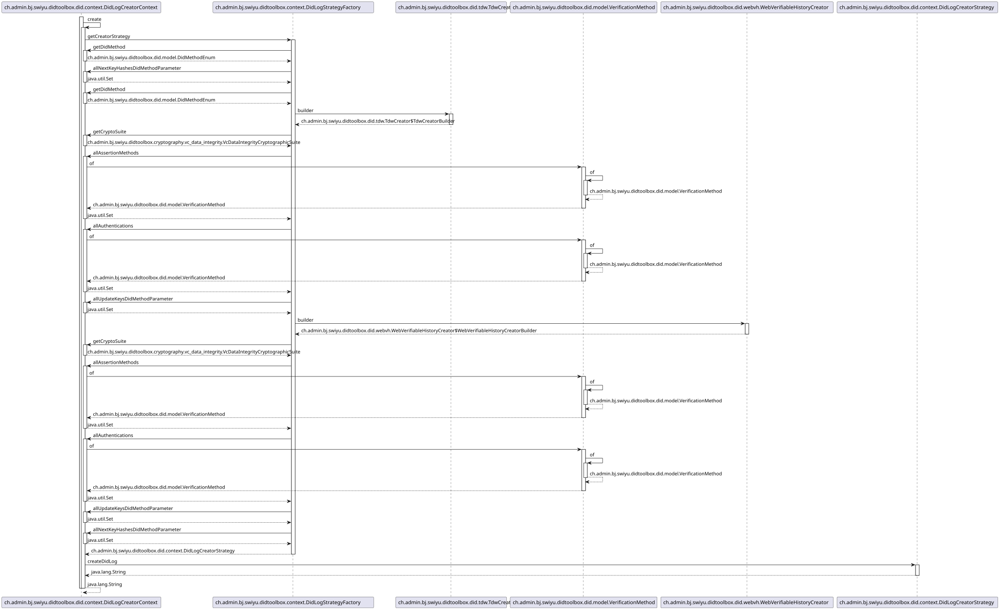
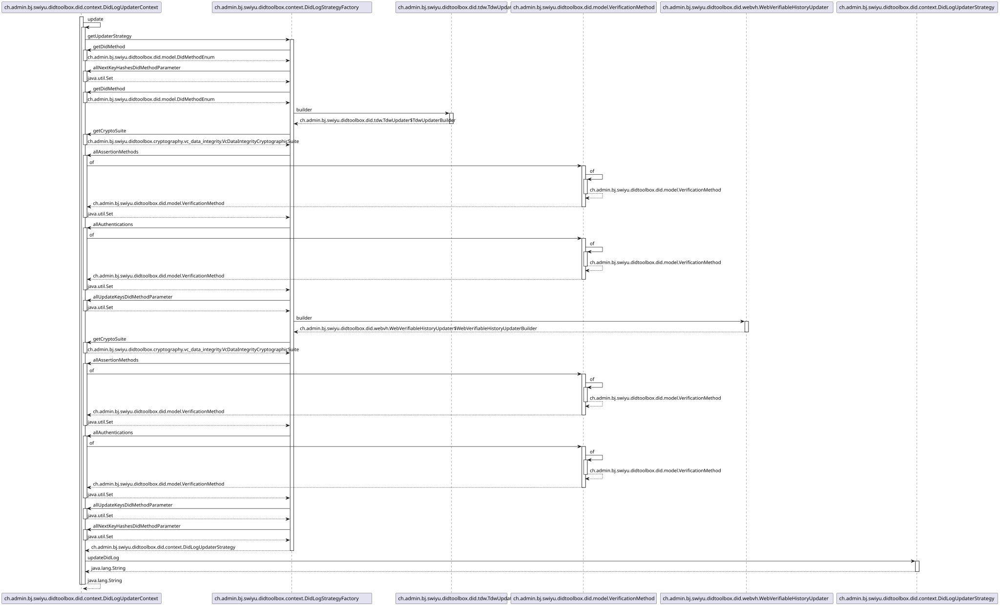
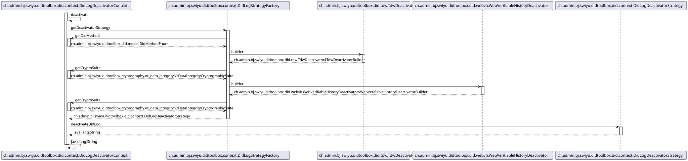

# PlantUML diagrams

## Class diagrams

### The DID Toolbox Java API (condensed)

### The DID Toolbox Java API (detailed)

## Sequence diagrams

### [DidLogCreatorContext#create](../java/ch/admin/bj/swiyu/didtoolbox/did/context/DidLogCreatorContext.java) method

### [DidLogUpdaterContext#update](../java/ch/admin/bj/swiyu/didtoolbox/did/context/DidLogUpdaterContext.java) method

### [DidLogDeactivatorContext#deactivate](../java/ch/admin/bj/swiyu/didtoolbox/did/context/DidLogDeactivatorContext.java) method

